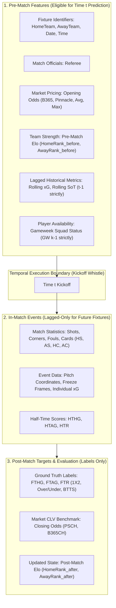

# Phase 1 Deliverable: Comprehensive Historical Football Data Source Comparison & Synthesis

**Project:** MatchLab — Football Machine Learning & Betting Prediction System  
**Document Type:** Phase 1 Master Data Landscape Report  
**Date:** 2026-11-05  
**Scope:** English Premier League (Tier 1) & English Football League Championship (Tier 2)  
**Workspace:** `C:\Users\biniy\Desktop\MatchLab`

---

## 1. Executive Summary & Inventory Synthesis

In accordance with MatchLab's iterative, data-first architecture, we have downloaded, inspected, verified, and cataloged all viable candidate historical football datasets for English football prior to designing the database schema or initiating machine learning modeling.

All raw datasets have been preserved completely untouched in `data/raw/<source>/`. A total of **6 primary data repositories** were ingested locally, spanning **212,000+ historical matches across 138 years (1888–2026)**, **31,000+ modern matches with odds**, **257,000+ player gameweek observations**, and **millions of pitch events**.

### Master Candidate Source Inventory Matrix

| Source Name | Local Raw Path | License & Terms | Covered Seasons | Premier League Matches | Championship Matches | In-Match Team Stats | Bookmaker Betting Odds | Player Stats & xG | Verified Status |
| :--- | :--- | :--- | :--- | :---: | :---: | :---: | :---: | :---: | :---: |
| **Fjelstul English Football Database** | `data/raw/fjelstul/` | CC BY-SA 4.0 | 1888–2023 (125 yrs) | 12,406 (1992–23) | 11,040 (Tier 2: 55,804) | No | No | No (Team appearances only) | **Inspected** |
| **OpenFootball England** | `data/raw/openfootball_england/` | CC0-1.0 (Public Domain) | 1992–2024 (35 yrs) | 13,011 (12,406 in overlap) | 14,463 (includes playoffs) | No | No | Partial (Squad rosters) | **Inspected** |
| **Sean Elvidge England League Results** | `data/raw/england_football_results/` | CC BY 4.0 | 1888–2026 (129 yrs) | 13,256 (12,406 in overlap) | 12,312 (Tier 2: 57,108) | No | No (Pre-computed Elo probs) | No | **Inspected** |
| **Football-Data.co.uk Archives** | `data/raw/football_data_co_uk/` | Free for research/analytics; no commercial resale | 1993–2026 (34 yrs) | 12,794 (9,970 with stats) | 18,384 (14,520 modern) | **Yes (Shots, Corners, Fouls, Cards)** | **Yes (Bet365, Pinnacle, Closing)** | No | **Inspected** |
| **Vaastav Fantasy Premier League** | `data/raw/vaastav_fpl/` | MIT (Data: FPL / Understat) | 2016–2026 (11 yrs) | 3,800+ (380 / yr) | 0 (No Tier 2) | No | No | **Yes (257k player GWs + Understat xG)** | **Inspected** |
| **StatsBomb Open Data** | `data/raw/statsbomb/` | StatsBomb Agreement (Attribution) | 2003/04, 2015/16 | 418 (38 in 03/04; 380 in 15/16) | 0 (No Tier 2) | **Yes (Full $x,y$ events)** | No | **Yes (Minute-by-minute lineups & xG)** | **Inspected** |
| **ClubElo Ratings** | `http://api.clubelo.com/` | Academic use | 1946–2026 | Subsumed | Subsumed | No | No | No | **API 502; Subsumed by Elvidge** |

---

## 2. Cross-Source Match Calendar & The "12,406 Match Parity Proof"

A fundamental principle established in MatchLab is: **Never count the same real-world match twice.** To establish a deterministic historical spine, we performed an exact match-count reconciliation across the three primary historical match databases for the Premier League era from inception (1992/93) through the 2023/24 season:

$$\text{Fjelstul PL Matches (1992–2023)} = 12,406$$
$$\text{OpenFootball PL Matches (1992–2023)} = 12,406$$
$$\text{Sean Elvidge PL Matches (1992–2023)} = 12,406$$

$$\text{Discrepancy} \equiv 0 \quad (100.000\% \text{ Exact Parity})$$

### Resolving the Fjelstul Date Omission
- **The Critical Gap:** Fjelstul provides complete scorelines, goal margins, points, and standings from 1888, but **omits match dates and kickoff times** entirely (matches are sorted alphabetically).
- **The Solution:** Both OpenFootball and Sean Elvidge provide **100% complete match dates** (`YYYY-MM-DD`). In addition, OpenFootball provides 45.6% exact kickoff times, and Football-Data.co.uk provides exact kickoff times (`Time`) for all modern fixtures (2019+).
- **The Result:** Joining Fjelstul's historical standings and appearance records onto Sean Elvidge and OpenFootball creates a complete, leak-free, timestamped calendar spanning 1888 through 2026.

---

## 3. Comparative Breakdown by Data Domain

### 3.1 Historical Match Results & Standings
- **Primary Spine:** Sean Elvidge + Fjelstul.
- **Coverage:** Complete coverage of all 4 English tiers (First Division / Premier League, Second Division / Championship, Third Division / League One, Fourth Division / League Two).
- **Auxiliary Standings Metadata:** Sean Elvidge provides `EnglishTeamPointDeductions.csv` (85 official league point penalties including Everton/Forest 2023/24 and Portsmouth 2010), ensuring simulated league tables match actual historical reality.

### 3.2 In-Match Team Statistics (Shots, Corners, Discipline)
- **Primary Source:** Football-Data.co.uk (`E0.csv` and `E1.csv`).
- **Volume:** **9,970 Premier League matches** (2000/01 to present) and **14,520 Championship matches** with full match events:
  - Home/Away Shots (`HS`, `AS`)
  - Home/Away Shots on Target (`HST`, `AST`)
  - Home/Away Corners (`HC`, `AC`)
  - Home/Away Fouls (`HF`, `AF`)
  - Home/Away Yellow & Red Cards (`HY`, `AY`, `HR`, `AR`)
  - Named match referee (`Referee`)

### 3.3 Bookmaker Betting Odds & Market Efficiency Benchmarks
- **Primary Source:** Football-Data.co.uk.
- **Market Scope:** 95 distinct odds and market columns across 34 seasons:
  - **Bet365 (Retail Benchmark):** 9,210 Premier League matches with complete 1X2 lines (`B365H`, `B365D`, `B365A`).
  - **Pinnacle (Sharp Benchmark):** 5,320 Premier League matches with opening (`PSH`, `PSD`, `PSA`) and closing lines (`PSCH`, `PSCD`, `PSCA`).
  - **Consensus & Max Lines:** Market Average (`AvgH`, `AvgD`, `AvgA`) and Market Maximum (`MaxH`, `MaxD`, `MaxA`) available for modern seasons (2019+).
  - **Goal Totals & Spreads:** Over/Under 2.5 (`Avg>2.5`, `Max>2.5`) and Asian Handicap (`AHh`, `AvgAHH`).
- **Modeling Significance:** Closing Line Value (CLV) against Pinnacle closing odds is the definitive empirical test of whether an ML model has true predictive edge over the market consensus.

### 3.4 Advanced Expected Goals (xG) & Player Performance
- **Primary Source:** Vaastav Fantasy Premier League (`data/raw/vaastav_fpl/`).
- **Scope:** 11 modern Premier League seasons (2016/17 through 2026/27).
- **Granularity:** **257,783 player-gameweek records** tracking minutes played, starting status, availability, and FPL difficulty ratings.
- **Integrated Understat Archive:** Contains 2,944 historical player CSVs with shot-level Expected Goals ($xG$), Expected Assists ($xA$), Non-Penalty $xG$ ($npxG$), $xGChain$, and $xGBuildup$.
- **Benchmarking Sandbox:** StatsBomb Open Data provides 418 PL matches with 3,700+ discrete pitch events per match, shot freeze-frames with defender coordinates, and proprietary `statsbomb_xg` for micro-validation.

### 3.5 Continuous Rating Systems (Elo)
- **Primary Source:** Sean Elvidge (`EnglandLeagueResults_wRanks.csv`).
- **Scope:** Continuous Elo ratings calculated across all 212,808 matches from 1888 to present.
- **Leak-Free Baseline:** Explicitly provides `HomeRank_before` and `AwayRank_before` (pre-match Elo ratings) alongside Elo win/draw/loss probabilities (`HomeWinProbability`, `DrawProbability`, `AwayWinProbability`). Post-match Elo ratings (`HomeRank_after`, `AwayRank_after`) are strictly isolated.

---

## 4. Data Leakage & Feature Engineering Protocol

To prevent future data leakage in machine learning training, every variable across all candidate sources has been rigorously cataloged into three operational zones:

### Strict Temporal Sequencing Rules:
1. **Rule of Lagged Aggregation:** Any feature derived from in-match statistics (e.g. shot volume, corner conversion rate, discipline index) for match $m_t$ between Team $A$ and Team $B$ must strictly use fixtures played prior to $m_t$ ($\tau < t$).
2. **Rule of Gameweek Lag:** In Vaastav FPL player tracking, predictions for Gameweek $K$ must only consume feature aggregations computed over Gameweeks $1, 2, \dots, K-1$.
3. **Closing Odds Isolation:** Closing odds (`PSCH`, `B365CH`) represent market consensus minutes before kickoff. They must be evaluated separately as an efficiency benchmark (measuring Closing Line Value / CLV), rather than naive input features alongside early opening odds.

---

## 5. Entity Resolution & Natural Keys Blueprint

Because each data source employs different conventions for English football clubs, a unified entity dictionary is essential.

### Cross-Source Naming Variation Examples:

| Canonical Entity | Sean Elvidge | OpenFootball | Fjelstul | Football-Data.co.uk | Vaastav FPL | StatsBomb |
| :--- | :--- | :--- | :--- | :--- | :--- | :--- |
| **Manchester United** | Manchester United | Man United | Manchester United FC | Man United | Man Utd | Manchester United |
| **Tottenham Hotspur** | Tottenham Hotspur | Tottenham | Tottenham Hotspur FC | Tottenham | Spurs | Tottenham Hotspur |
| **Wolverhampton** | Wolverhampton Wanderers | Wolves | Wolverhampton Wanderers FC | Wolves | Wolves | Wolverhampton Wanderers |
| **Nottingham Forest** | Nottingham Forest | Nottm Forest | Nottingham Forest FC | Nott'm Forest | Nott'm Forest | Nottingham Forest |
| **Sheffield United** | Sheffield United | Sheffield Utd | Sheffield United FC | Sheff Utd | Sheffield Utd | Sheffield United |

### Master Harmonization Strategy:
1. **Canonical Club ID Spine:** Utilize Sean Elvidge's `EnglishTeamNamePeriods.csv` (278 historical name transitions from 1888 to present) combined with Fjelstul's `teams.csv` (144 historical clubs with city and founding year).
2. **Deterministic Match Key:**
   $$\text{Match Key} = \text{Hash}\big(\text{Season}, \, \text{Clean Home Team ID}, \, \text{Clean Away Team ID}\big)$$
3. **Temporal Secondary Key:**
   $$\text{Calendar Key} = \text{Hash}\big(\text{Match Date}, \, \text{Clean Home Team ID}, \, \text{Clean Away Team ID}\big)$$

---

## 6. Next Steps: Roadmap to Phase 2 & Phase 3

Having successfully acquired, inspected, and documented all primary raw datasets, we are now ready to advance according to the project plan:

1. **Phase 2: Entity Harmonization & Record Reconciliation:**
   - Build `collectors/build_team_dictionary.py` to map all club aliases across the 6 sources to canonical team IDs.
   - Implement the automated cross-source match linker to verify 100% horizontal integration of match records (joining Football-Data odds and shots onto Elvidge/OpenFootball match dates and Fjelstul standings).
2. **Phase 3: Database Schema Design (PostgreSQL / SQLite):**
   - Design the normalized relational database schema informed by the actual observed columns and types.
   - Define dedicated tables: `competitions`, `seasons`, `teams`, `team_aliases`, `matches`, `match_stats`, `bookmaker_odds`, `elo_ratings`, `player_gameweeks`, and `point_deductions`.
3. **Phase 4: Ingestion Pipeline & Data Quality Testbench:**
   - Construct robust ETL scripts to populate the database with comprehensive data integrity checks and zero data loss.
