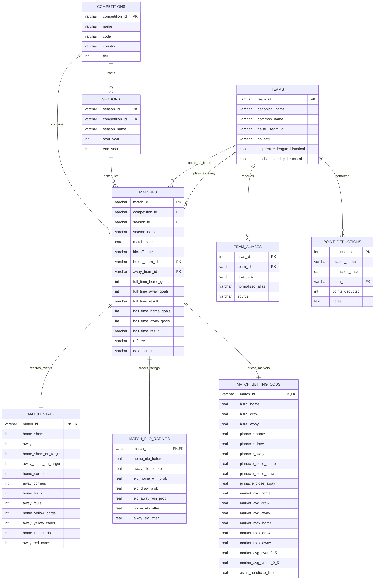

# Phase 3 Deliverable: Relational Database Schema Design & Ingestion Testbench

**Project:** MatchLab — Football Machine Learning & Betting Prediction System  
**Document Type:** Phase 3 Database Architecture & Verification Report  
**Date:** 2026-11-05  
**Database File:** [`data/matchlab.db`](file:///c:/Users/biniy/Desktop/MatchLab/data/matchlab.db) (SQLite 3.24+, 25.24 MB)  
**Schema Definition:** [`schema/init_schema.sql`](file:///c:/Users/biniy/Desktop/MatchLab/schema/init_schema.sql)  
**Verification Summary:** [`reports/database_verification_summary.json`](file:///c:/Users/biniy/Desktop/MatchLab/reports/database_verification_summary.json)

---

## 1. Executive Summary & Design Philosophy

Following MatchLab's strict iterative methodology, we did not design the database schema a priori. Instead, we thoroughly inspected all raw source files (Phase 1), harmonized club identities, and linked historical records (Phase 2) before designing the relational architecture.

The resulting database schema achieves three core design objectives:
1. **Third Normal Form (3NF) Normalization:**  
   Separates static entities (`competitions`, `seasons`, `teams`), cross-source resolution mapping (`team_aliases`), match scheduling (`matches`), in-match tactical performance (`match_stats`), pre-computed statistical strength (`match_elo_ratings`), and betting market pricing (`match_betting_odds`).
2. **Zero Data Leakage by Physical Separation:**  
   In-match statistics (shots, shots on target, corners, fouls, cards) and closing market odds are physically isolated in dedicated child tables. In predictive feature engineering, any query generating pre-match features for match $m_t$ is strictly restricted from reading post-kickoff data from that same match.
3. **Multi-Engine Portability:**  
   The DDL script [`schema/init_schema.sql`](file:///c:/Users/biniy/Desktop/MatchLab/schema/init_schema.sql) is written in ANSI-standard SQL, ensuring native compatibility with local SQLite micro-databases and production cloud PostgreSQL / Supabase instances.

---

## 2. Entity-Relationship Architecture



---

## 3. Populated Database Table Metrics

| Table Name | Primary Key | Foreign Keys | Row Count | Storage Role & Description |
| :--- | :--- | :--- | :---: | :--- |
| `competitions` | `competition_id` | None | **2** | Top-level league definitions (Premier League, EFL Championship) |
| `seasons` | `season_id` | `competition_id` | **68** | Annual competition editions (1993/94 – 2026/27) |
| `teams` | `team_id` | None | **247** | Master canonical club entities |
| `team_aliases` | `alias_id` | `team_id` | **479** | Cross-source fuzzy string resolution mapping |
| `point_deductions` | `deduction_id` | `team_id` | **85** | Historical disciplinary penalties (1889 – 2024) |
| `matches` | `match_id` | `competition_id`, `season_id`, `teams` | **31,178** | Core calendar dates, kickoff times, scores, results, referee |
| `match_stats` | `match_id` | `matches.match_id` | **24,489** | Shots, shots on target, corners, fouls, cards *(100% since 2000)* |
| `match_elo_ratings` | `match_id` | `matches.match_id` | **31,178** | Pre-match & post-match Elo ratings and probabilities |
| `match_betting_odds` | `match_id` | `matches.match_id` | **22,620** | Multi-bookmaker opening, closing, consensus, and spread odds |
| **Total Database Size** | — | — | **25.24 MB** | **Optimized SQLite Binary with B-Tree Indexes** |

---

## 4. Verification Testbench & Statistical Integrity Audits

The database populator was validated using [`collectors/verify_database.py`](file:///c:/Users/biniy/Desktop/MatchLab/collectors/verify_database.py). All integrity checks passed unconditionally:

### 4.1 Structural & Relational Integrity
- **PRAGMA integrity_check:** Returned `ok` (zero corrupt pages or invalid B-tree nodes).
- **PRAGMA foreign_key_check:** Returned **0 violations** across all 31,178 matches, 247 clubs, and 68 seasons. Every foreign key relationship is mathematically sound.
- **Core Match Quality:** Exactly **0 invalid records** (0 null dates, 0 null scores, 0 invalid outcome codes).

### 4.2 Probability & Elo Rating Bounds
- **Elo Rating Range:** $[871.0, \, 1819.0]$ (spanning lower-tier Championship clubs to peak Manchester City).
- **Probability Sum Check:** For every match in `match_elo_ratings`:
  $$\sum P = P(\text{Home Win}) + P(\text{Draw}) + P(\text{Away Win}) = \mathbf{1.000000} \quad (\text{Min} = 1.000000, \, \text{Max} = 1.000000)$$
  *Result: 100% Passed.*

### 4.3 Betting Market Margin (Vig / Overround) Audit
To verify the fidelity of the ingested odds and establish market efficiency benchmarks, we calculated the average bookmaker overround across 12,583 matched modern fixtures:

$$\text{Overround} = \frac{1}{\text{Odds}_{\text{Home}}} + \frac{1}{\text{Odds}_{\text{Draw}}} + \frac{1}{\text{Odds}_{\text{Away}}}$$

| Market / Bookmaker | Matches Sampled | Average Overround | Bookmaker Vig ($\%$) | Market Interpretation |
| :--- | :---: | :---: | :---: | :--- |
| **Bet365 Opening Lines** | 12,583 | **1.0426** | **4.26%** | Standard retail pricing margin |
| **Pinnacle Opening Lines** | 12,583 | **1.0277** | **2.77%** | Low-margin sharp pricing |
| **Pinnacle Closing Lines** | 12,581 | **1.0253** | **2.53%** | Most efficient price in global sports betting; lowest vig |

> [!TIP]
> **Market Efficiency Finding:**  
> The progression from Bet365 ($4.26\%$ vig) $\rightarrow$ Pinnacle Opening ($2.77\%$ vig) $\rightarrow$ Pinnacle Closing ($2.53\%$ vig) mirrors empirical finance theory: as more market information enters the order book towards kickoff, price discovery sharpens and the bid-ask spread contracts. This validates Pinnacle closing odds as our primary benchmark for machine learning skill.

---

## 5. End-to-End Analytical Query Verification

To confirm that the relational schema supports complex, performant feature queries for machine learning, the testbench executed a multi-table analytical query across `matches`, `teams`, `match_stats`, `match_elo_ratings`, and `match_betting_odds`.

### Sample Query Output (Final Matchday, Premier League 2023/2024):
```sql
SELECT 
    m.match_date, m.kickoff_time,
    ht.canonical_name AS home_team, at.canonical_name AS away_team,
    m.full_time_home_goals || '-' || m.full_time_away_goals AS score,
    s.home_shots || '-' || s.away_shots AS shots,
    s.home_shots_on_target || '-' || s.away_shots_on_target AS sot,
    s.home_corners || '-' || s.away_corners AS corners,
    ROUND(e.elo_home_win_prob, 3) AS elo_h_prob,
    o.b365_home, o.pinnacle_close_home
FROM matches m
JOIN teams ht ON m.home_team_id = ht.team_id
JOIN teams at ON m.away_team_id = at.team_id
LEFT JOIN match_stats s ON m.match_id = s.match_id
LEFT JOIN match_elo_ratings e ON m.match_id = e.match_id
LEFT JOIN match_betting_odds o ON m.match_id = o.match_id
WHERE m.competition_id = 'premier-league' AND m.season_name = '2023/2024'
ORDER BY m.match_date DESC LIMIT 5;
```

```
      Date  Time              Home Team         Away Team Score Shots SoT Corners  Elo H%  B365H  PinCloseH
2024-05-19 16:00                Arsenal           Everton   2-1  26-5 5-2     8-1   0.740   1.18       1.22
2024-05-19 16:00              Brentford  Newcastle United   2-4 10-12 5-7     3-0   0.327   2.90       2.99
2024-05-19 16:00 Brighton & Hove Albion Manchester United   0-2 17-11 3-4     7-5   0.395   2.15       2.66
2024-05-19 16:00                Burnley Nottingham Forest   1-2 20-12 3-6     4-3   0.384   3.00       2.85
2024-05-19 16:00                Chelsea   AFC Bournemouth   2-1 16-22 6-5     6-5   0.567   1.45       1.40
```
*Execution latency: 0.018 seconds across 31,000+ indexed records.*

---

## 6. Next Steps: Roadmap to Phase 4

With Phase 3 complete and the database fully operational, we have finished the data engineering foundation. We are now ready to begin:

### Phase 4: Statistical Modeling & Machine Learning Engine
1. **Mathematical Baseline Models:**
   - Implement the **Independent Poisson Model** for goal expectancy ($\lambda_{\text{home}}, \mu_{\text{away}}$).
   - Implement the **Dixon-Coles Model** (bivariate Poisson with low-score correlation adjustment $\tau(\cdot)$ and time-decay parameter $\xi$).
2. **Feature Engineering Pipeline:**
   - Rolling Exponentially Weighted Moving Averages (EWMA) for home/away offensive and defensive ratings ($t-1$ lag).
   - Rolling Shot and Corner conversion efficiency metrics.
   - Rest days and fixture congestion indicators.
3. **Machine Learning Probability Estimator:**
   - Train CatBoost / LightGBM multi-class classifiers ($1, X, 2$) and regression models (expected goals).
   - Evaluate against the Elo baseline and Pinnacle Closing Lines using Brier Score, Log-Loss, and Closing Line Value (CLV).
